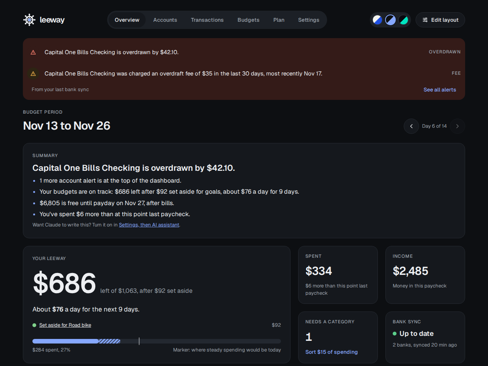
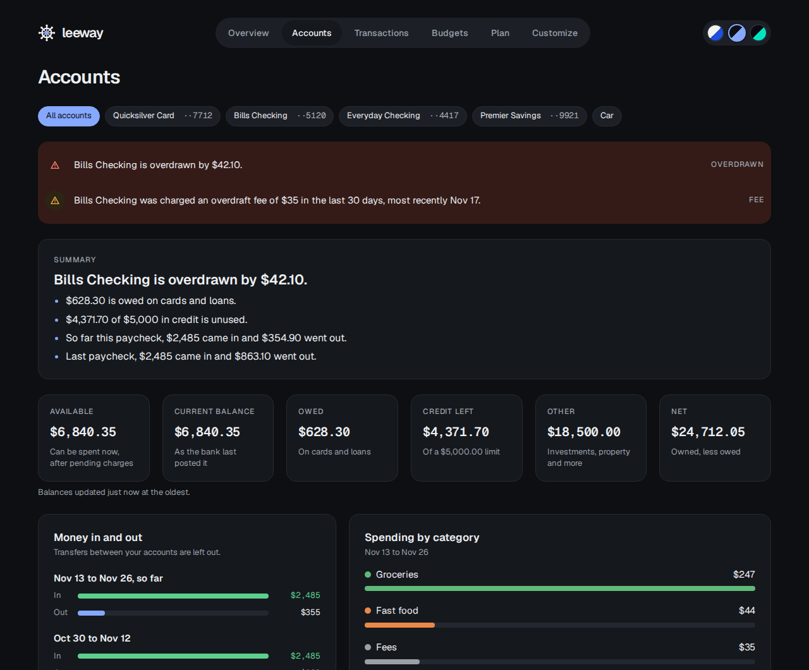
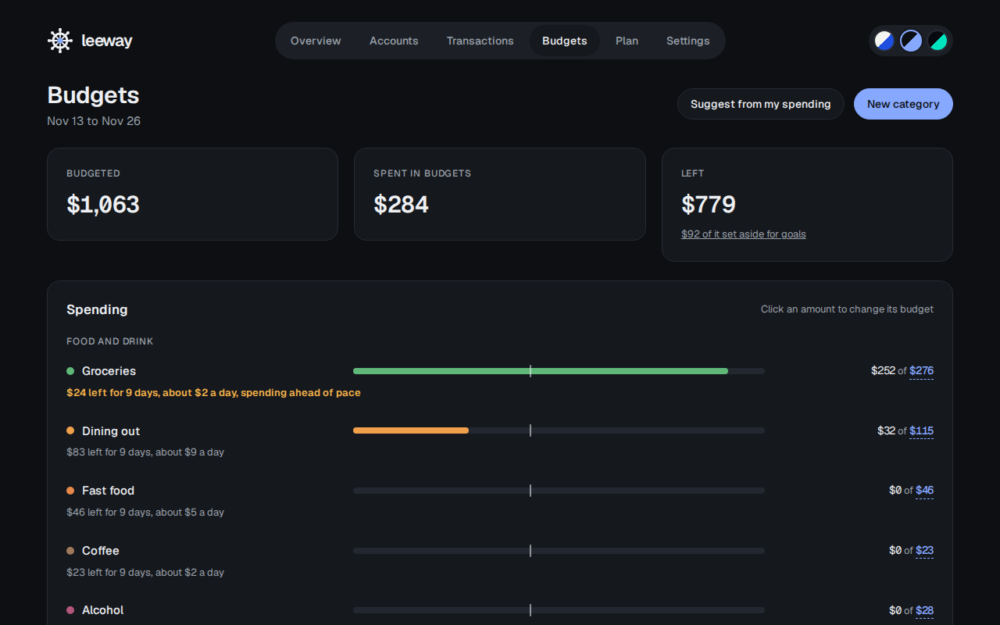
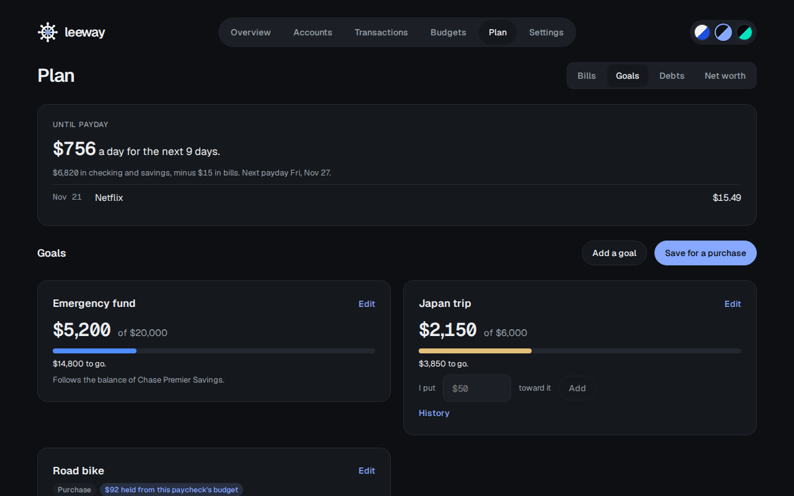
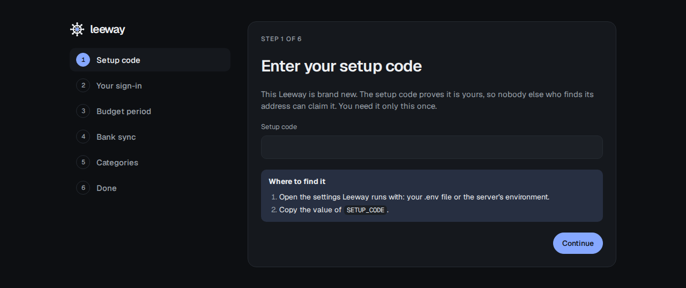
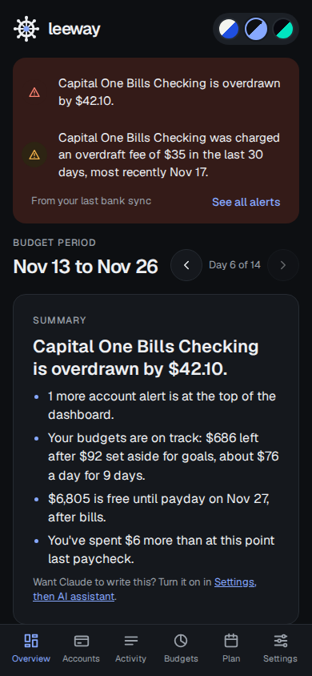
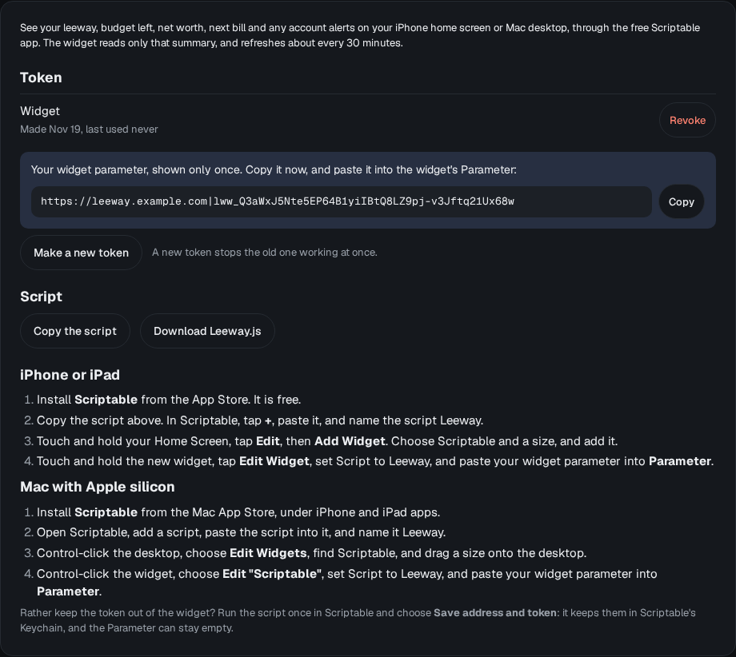

<p align="center">
  
</p>

# Leeway

A free budget tracker you host yourself, with bank sync and a secure link for
your AI assistant.

Your financial data stays on your own server. It leaves only to talk to your
bank, and nothing in Leeway can ever move money.

**What it does**

- **Budgets** by month, paycheck or week, with a safe amount to spend per day
  and a warning before you go over.
- **Bank sync** through Plaid, or **CSV import** and accounts added by hand
  if you'd rather not connect a bank.
- **An overview dashboard** you arrange yourself: what is left to spend, net
  worth, account alerts, money in against money out, and your spending pace.
- **An accounts dashboard** for one account or several: balances, money in and
  out, spending by category and recent transactions.
- **Account alerts** when an account is overdrawn, a card is over its limit, a
  balance is low or an overdraft fee was charged, and for money leaking away:
  a charge that went through twice, or a repeating charge that went up in price.
- **Planning**: bills and subscriptions, recurring charges found for you,
  savings goals, debt payoff plans, cash until payday (and cash in checking
  that could earn more in savings, at a stated rate) and net worth.
- **Savings and investments**: savings, retirement and investing accounts
  sorted for you (or as you mark them), daily balance history, an emergency
  fund counted in months of essential spending, and your savings rate. An AI
  assistant can read all of it today.
- **Credit card interest in dollars**: what carrying each card's balance past
  the due date costs a month at its APR, and all your cards together. Add a
  card's APR from its statement.
- **An AI coach.** Claude, or any assistant that speaks MCP, can check in on
  your money with your real numbers. You choose whether it may only look or
  also change budgets.
- **Works on laptop and phone**, and installs to your home screen like an app.

## Screenshots



| Accounts dashboard                                                                 | Budgets                                                                          |
| ---------------------------------------------------------------------------------- | -------------------------------------------------------------------------------- |
|  |   |
| **Plan: goals and cash until payday**                                              | **First run: the setup wizard**                                                  |
|      |  |

<p align="center">
  
</p>

The screenshots use invented demo data.

## Contents

- [Quick start](#quick-start)
- [Bank sync with Plaid](#bank-sync-with-plaid)
- [Configuration](#configuration)
- [Connect an AI assistant](#connect-an-ai-assistant)
- [Home-screen widget](#home-screen-widget)
- [Security](#security)
- [Updating and backups](#updating-and-backups)
- [Contributing](#contributing)
- [Publishing the Railway template](#publishing-the-railway-template)
- [License](#license)

## Quick start

Leeway needs a server and a PostgreSQL database. Pick one of these.

### Deploy on Railway

<!--
  PLACEHOLDER: TEMPLATE_CODE in the button link below is not a real template yet.
  Replace it with the published template's code, then delete this comment and
  the placeholder note under the button. See "Publishing the Railway template".
-->

[](https://railway.com/new/template/TEMPLATE_CODE?utm_medium=integration&utm_source=button&utm_campaign=leeway)

> **Placeholder:** the button goes live once the template is published (see
> [Publishing the Railway template](#publishing-the-railway-template)). Until
> then, use the steps under [Without the button](#without-the-button).

The button creates a Railway project with Leeway and its own database,
generates an encryption key and a setup code, and gives Leeway a public
address.

1. Click **Deploy on Railway**, sign in to Railway, and choose **Deploy**.
   Every setting is already filled in or optional.
2. When the deploy finishes, open the address shown on the Leeway service. It
   ends in `.up.railway.app`.
3. Leeway asks for a setup code, so nobody else who finds the address can
   claim it. On the Leeway service, open **Variables** and copy `SETUP_CODE`.
4. Create your sign-in and follow the setup screens. Bank sync is optional.
5. Copy `ENCRYPTION_KEY` from the same **Variables** tab and keep it somewhere
   safe, like a password manager. Without it, connected banks have to be
   linked again.

#### Without the button

1. In [Railway](https://railway.com), create a project, choose **Deploy from
   GitHub repo** and pick your copy of this repository.
2. Add a database: **New**, then **Database**, then **PostgreSQL**.
3. On the Leeway service, open **Variables** and add:
   - `DATABASE_URL` set to `${{Postgres.DATABASE_URL}}`
   - `ENCRYPTION_KEY` set to 64 random hex characters. `openssl rand -hex 32`
     makes one. Keep a copy somewhere safe.
4. Under **Settings**, then **Networking**, click **Generate Domain**.
5. Open that address. For the setup code, open the latest deployment's **Deploy
   Logs** and copy the code from the newest line that starts `No account yet`.
   Leeway makes a new one each time it starts until your account exists. To
   choose your own, set `SETUP_CODE` (12 characters or more) in **Variables**.
6. Create your sign-in and follow the setup screens.

If a required setting is missing, the deploy log says which one and what to
set it to.

### Run with Docker on your own machine

You need [Docker](https://docs.docker.com/get-docker/) with Compose (Docker
Desktop includes both) and `git`.

```sh
git clone https://github.com/David5280/Leeway.git
cd Leeway
cp .env.example .env
```

Open `.env` and set `ENCRYPTION_KEY` to the output of `openssl rand -hex 32`.
Keep a copy somewhere safe. Everything else can stay empty for now. Then start
Leeway and its database:

```sh
docker compose up -d
```

Open http://localhost:3000. For the setup code, use `SETUP_CODE` from `.env`
if you set one; otherwise run `docker compose logs leeway` and copy the code
from the newest line that starts `No account yet`.

The database lives in a Docker volume, so it survives restarts and upgrades.
After changing `.env`, run `docker compose up -d` again to apply it.

### Run from source

You need Node.js 22.12 or newer and PostgreSQL.

```sh
npm install
cp .env.example .env   # then set DATABASE_URL and ENCRYPTION_KEY
npm run build
npm start
```

The setup code is `SETUP_CODE` from `.env`, or the code at the end of the line
Leeway prints at startup that starts `No account yet`.

## Bank sync with Plaid

Bank sync is optional. Without it, import CSV files from your bank
(**Transactions**, then **Import a file**) or add accounts by hand
(**Settings**, then **Accounts**). [Plaid](https://plaid.com) is the service
many budgeting apps use to reach banks. Leeway uses it only to read balances
and transactions.

1. Make a free account at [dashboard.plaid.com](https://dashboard.plaid.com).
2. Open **Developers**, then
   [**Keys**](https://dashboard.plaid.com/developers/keys), and copy your
   `client_id` and your **Sandbox** secret. Each Plaid environment has its own
   secret.
3. Set `PLAID_CLIENT_ID` and `PLAID_SECRET` where Leeway runs: in the Leeway
   service's **Variables** on Railway, or in `.env` followed by
   `docker compose up -d` with Docker. The app never asks for these keys.
4. In Leeway, open **Settings**, then **Banks**, and choose **Connect a
   bank**.

**Sandbox has only test banks.** Sign in to any of them with `user_good` and
password `pass_good`. Your real bank needs Production access from Plaid:

- **In the US and Canada**, Plaid teams created on or after April 15, 2026 can
  use the free **Trial plan**: real banks, up to 10 bank logins, with
  Transactions and Balance included. Removing a bank does not free its spot.
  You apply when you sign up; Plaid approves most applications automatically
  after an identity check and answers flagged ones by email within 2 to 3
  business days.
- **Anywhere else, or for more banks**, choose **Get production access** in
  the Plaid dashboard. It asks about your business, the products you need and
  who owns the business, and has you pick a paid plan. Plaid says approval
  takes a couple of business days.

Once approved, set `PLAID_ENV` to `production` and `PLAID_SECRET` to your
**Production** secret, the same way as before.

Sources: Plaid's
[Sandbox overview](https://plaid.com/docs/sandbox/),
[What is the Plaid Trial plan](https://support.plaid.com/hc/en-us/articles/39994173227159-What-is-the-Plaid-Trial-plan),
[How are Sandbox, Production, Trial plan and Limited Production different](https://support.plaid.com/hc/en-us/articles/16110110883479-How-are-Sandbox-Production-Trial-plan-and-Limited-Production-different)
and
[How do I upgrade from the Trial plan to a paid Production plan](https://support.plaid.com/hc/en-us/articles/39917307426967-How-do-I-upgrade-from-the-Trial-plan-to-a-paid-Production-plan),
read November 2026.

## Configuration

The server reads environment variables (`.env` with Docker or from source,
**Variables** on Railway). Everything else, from your budget period to themes,
is chosen in the app under **Settings**. `.env.example` lists every variable
with a note.

| Variable                | Needed   | What it does                                                           |
| ----------------------- | -------- | ---------------------------------------------------------------------- |
| `DATABASE_URL`          | Yes      | Postgres connection string. Docker Compose sets it for you.            |
| `ENCRYPTION_KEY`        | Yes      | 64 hex characters that encrypt bank access tokens.                     |
| `SETUP_CODE`            | No       | Your own code for creating the account, instead of the logged one.     |
| `PUBLIC_URL`            | No       | Your Leeway address, for bank webhooks, assistants and the email.      |
| `TRUST_PROXY`           | No       | Proxies in front of Leeway (see [Security](#security)); usually empty. |
| `PLAID_CLIENT_ID`       | For sync | From the Plaid dashboard.                                              |
| `PLAID_SECRET`          | For sync | From the Plaid dashboard.                                              |
| `PLAID_ENV`             | No       | `sandbox` (test banks, the default) or `production`.                   |
| `PLAID_COUNTRY_CODES`   | No       | Countries to offer banks from, like `US,CA`. Default `US`.             |
| `PLAID_REDIRECT_URI`    | No       | Needed by some banks that sign in through their own site.              |
| `SYNC_INTERVAL_MINUTES` | No       | How often to sync banks, default 360. `0` turns it off.                |
| `ANTHROPIC_API_KEY`     | No       | Lets Claude write the dashboard summary and read imported paystubs.    |
| `SUMMARY_MODEL`         | No       | Fixes the summary's Claude model, instead of choosing it in Settings.  |
| `PAYSTUB_MODEL`         | No       | Fixes the paystub reader's model, instead of choosing it in Settings.  |
| `RESEND_API_KEY`        | No       | Lets Leeway send the weekly email.                                     |
| `MAIL_FROM`             | No       | The weekly email's sender, like `Leeway <leeway@example.com>`.         |
| `DATABASE_SSL`          | No       | `true` or `false`. By default, TLS for any database not on this host.  |
| `PORT`                  | No       | The port Leeway listens on, default 3000.                              |
| `HOST`                  | No       | The address Leeway listens on, default `0.0.0.0`.                      |

On Railway, `PUBLIC_URL` is filled in from the generated domain.

### Claude-written summary (optional)

Leeway writes the dashboard summary from your numbers on its own. To have
Claude write it instead, set `ANTHROPIC_API_KEY` (from the
[Anthropic Console](https://console.anthropic.com)), then turn on **Have Claude
write it** in **Settings**, then **AI assistant**. Nothing is sent until you
turn it on. Claude then gets this period's totals, the Heads up list, bill and
goal names, and any account alerts, which name the account the way Leeway shows
it, like "Chase Total Checking is down to $35.00". It never gets account
numbers or transactions. A summary is reused while your numbers stay the same,
for up to four hours, and with the default model each one costs well under a
cent on your own Anthropic account. The model and a monthly limit are set in
[AI models](#ai-models-and-the-monthly-limit).

### Paystub import (optional)

With `ANTHROPIC_API_KEY` set, **Import a paystub** appears in **Plan**, then
**Retirement**, and on a pension's form. Upload a PDF, PNG or JPEG of a
paystub (a PDF of up to 10 MB or a photo of up to 5 MB, a page or two long)
and Claude reads its pay, pension, 401(k), 457, 403(b) and HSA figures, this
period's and the year's.
You see each figure with the line it came from and how sure Claude is, change
any of them, and choose whether they update a pension or your monthly
retirement saving. Nothing is saved until you choose **Save**.

- The whole file goes to Anthropic as it is, with a fixed instruction. That
  includes any Social Security number, account number or address printed on
  it. Nothing else of yours goes with it.
- It goes first to count its length, which costs nothing, and then, only if
  it is short enough to be a paystub, to be read. A longer file is refused
  and never read: save just the page or two with your pay figures.
- The file stays in memory for that request: it is never written to disk or
  to the database. Leeway keeps only the figures you save.
- Leeway takes Social Security numbers, labeled IDs (such as an employee ID
  or an account number after its label) and long numbers out of every line
  it shows or keeps, along with street addresses. A masked account ending,
  such as the last four digits, may still show.
- A file read once is not sent again while Leeway keeps running, for up to a
  day, and at most 10 new files are read an hour, which keeps the cost on
  your own Anthropic account small.
- No assistant tool can read or save a paystub.

An iPhone photo saved as HEIC is not read yet; take a screenshot of it, or set
the camera to **Most Compatible**.

### AI models and the monthly limit

Every paid AI call, the summary and the paystub reader today, goes through
one place that picks the model, checks a monthly limit and records what the
call cost. **Settings**, then **AI models** shows:

- this month's AI spending against the limit, in all and by job;
- the monthly limit, $5 to start, from $0 (paid AI off) to $1,000;
- the model for each job, with what it is for and its price per million
  tokens. Both jobs start on Claude Haiku 5.5, the small, cheap model.
  Claude Sonnet 5.5 and Claude Opus 5.5 cost about 20 and 40 times as much.

How the limit works:

- The month follows the time zone in **Settings**, then **Budgeting**.
- Before each call, Leeway works out the most it could cost: the prompt
  (counted free by Anthropic for a paystub file, estimated from its length
  for the summary's short text) as if every token were a cache write, plus
  the most output the call may use. If that would take the month past the
  limit, the call is not made. The summary is then Leeway's own, and the
  paystub reader says the limit is reached and when it resets.
- After the call, the tokens it really used (input, output, cache reads and
  writes) are priced and recorded. Prices are Anthropic's list prices,
  checked on 2026-11-19, so your Anthropic bill is the final word.
- Each call is one attempt; Leeway never retries on its own. A call Anthropic
  answers with an error (the key refused, rate limited, overloaded, a server
  error, a request too large or unreadable, or a model it doesn't have) is
  not billed, so nothing is recorded. Only a call that gets no answer (it
  times out or loses its connection) or an answer Leeway can't read may have
  been billed unseen, so its most possible cost is recorded, marked as an
  estimate.
- At 80% of the limit a warning shows once in **Heads up** and in Settings,
  and once the month's spending reaches the limit, a second alert says so.
  A single call turned away while some of the limit is left only says so
  where it was asked for. Either alert can be dismissed, and a new limit
  starts the month's alerts over.
- Each record holds token counts and a cost, never what was asked or
  answered.

`SUMMARY_MODEL` or `PAYSTUB_MODEL` fixes that job's model on the server, and
Settings then shows it locked. When Anthropic says it has no such model
(retired or mistyped), Settings and the summary card say so and where to pick
another, and a model with an announced retirement day shows that day. A model
Leeway has no price for is counted at the price of the dearest model it knows,
so the limit still holds. No assistant can see or change any of this over MCP,
since it decides what is spent on your Anthropic account; an assistant still
sees the chosen models and the limit in Leeway's settings.

### Weekly email (optional)

Once a week, Leeway can email you any account alerts, the dashboard summary,
what's left this period, bills before payday and your goals. It sends through
[Resend](https://resend.com), since many hosts block outgoing SMTP.

1. Make a free Resend account and verify your domain under **Domains**.
2. Make an API key under **API Keys** (sending access is enough).
3. Set `RESEND_API_KEY` to that key and `MAIL_FROM` to an address on the
   verified domain.
4. In **Settings**, then **Email**, turn it on and choose the day, the hour
   and the address. **Send a test email now** shows you one straight away.

Only you can turn it on, in the app. Connected assistants can neither see nor
change the email or its address.

### Notifications (nothing to set)

The bell at the top of every screen opens the **inbox**: each alert as it
happens, newest first. Open one to go to the screen that explains it (it is
then read), or dismiss it. Leeway checks every few minutes and after each bank
sync, and tells you about:

- an account overdrawn, a card over its limit, an overdraft fee, or a balance
  under its low-balance warning;
- a budget reaching a share you choose (100% by default), until it is back
  under;
- a bill not on autopay coming due (2 days before, by default), until it is
  paid;
- a single charge of at least an amount you choose ($500 by default);
- the same charge at one place twice within 3 days (not a habit there, and not
  refunded since), or a charge that repeats quarterly or more often and isn't a
  bill yet going up in price on its usual cycle (a bill's own change alert
  covers a tracked bill, and a bill paid twice is told once, as the charge
  made twice). Cash, checks, payments to people, transfers and bank fees are
  never either;
- a bank that needs you to sign in again;
- AI spending near or at this month's limit, once each as it happens (see
  [AI models](#ai-models-and-the-monthly-limit)).

Each is the same alert you already see in the app, worked out by plain rules,
with no AI involved. The same alert is never stored twice: a condition that
clears and comes back within an hour picks up where it was, and old items are
deleted after 90 days.

A problem you dismiss that is still there a day later, like an account still
overdrawn, a bill still unpaid or a bank still waiting for you to sign in,
comes back unread, with no second push. Everything else stays dismissed: a fee
or a large charge is news, and a budget gone over can't be undone until the
next period. Dismissing an account alert takes it off the home screen too; a
problem like an overdrawn account stays off only while its kind of
notification is on.
Each account alert on the home screen also has a close button, which hides it
from home only and leaves the inbox as it was. A hidden fee stays hidden, and
any other alert comes back after a day if it is still there. An alert that
clears for over an hour and then returns counts as new and shows again.

**Push to your phone or computer** needs nothing in your configuration. On its
first start Leeway makes its own Web Push keys and keeps them in the database,
encrypted under your `ENCRYPTION_KEY`; they are never in your variables or
logs. In **Settings**, then **Notifications**, press **Turn on** on each device
that should get pushes, and **Send a test notification** to see one.

- **On iPhone and iPad**, push works only once Leeway is on the Home Screen:
  open it in Safari, tap Share, then **Add to Home Screen**, and open it from
  there. The Settings screen says so when it is needed.
- **Quiet hours** (10 PM to 7 AM in your time zone, by default) hold pushes
  until they end; the inbox still gets each alert at once.
- **A burst becomes one push.** Leeway sends at most one push every 15
  minutes. Alerts that pile up meanwhile go out together as one, like "3 new
  alerts", and nothing is pushed for an alert you have already read,
  dismissed or turned off, or one that has cleared. One that clears and comes
  back before its push went out is still pushed.
- **What a push says.** Browsers carry every push through their maker's push
  service (Apple, Google, Mozilla or Microsoft), encrypted end to end, and the
  words then show on your lock screen. So a push holds a short title and the
  account, category or bill name as you see it in Leeway: never an amount,
  account number, merchant or bank text. The detail is in the inbox.
- A device whose push service says it is gone is forgotten. If you change
  `ENCRYPTION_KEY`, Leeway makes new push keys and forgets every device. In
  both cases the device's Settings show **Turn on** again, and pressing it
  replaces the browser's old subscription with a new one.
- **Who a push is from.** Each push names your Leeway address to the push
  service: `PUBLIC_URL` when it is `https`, otherwise the `https` address the
  device turned push on from. Apple refuses pushes without one, so on iPhone
  turn push on from your `https` address, not a local one.

Each kind of alert has its own switch, and turns it off in the inbox and for
push alike. Only you can see the inbox or change these settings: connected
assistants read the same facts through their own alert, budget and bill tools,
and can't mark anything read or dismiss it.

## Connect an AI assistant

Your connector address is your Leeway address followed by `/mcp`, like
`https://leeway-yourname.up.railway.app/mcp`. **Settings**, then **AI
assistant**, shows it with a Copy button.

- **Claude (web, desktop or phone).** In Claude, open **Customize**, then
  **Connectors**, and choose **Add custom connector**. Name it Leeway, paste
  the address and choose **Connect**. Claude's connectors reach Leeway from
  the internet, so this needs a public `https` address, which Railway gives
  you.
- **Claude Code.** Run this, then `/mcp` inside Claude Code to sign in:

  ```sh
  claude mcp add --transport http leeway https://your-leeway-address/mcp
  ```

- **Other assistants.** Any assistant that speaks MCP over HTTP can connect.
  If it can sign in with OAuth, give it the address. If it needs a bearer
  token, create a key in **Settings**, then **AI assistant**.

When an assistant signs in, Leeway asks you to approve it and choose what it
may do:

- **Look only:** read accounts, spending, budgets, goals and alerts.
- **Look and change:** also edit budgets, categories, rules and goals.

Neither can move money, pay a bill or cancel a subscription. Every connected
app and key is listed in **Settings**, then **AI assistant**, where you can
revoke it at once.

Then ask for a money check-in, or whether you can afford something.
Assistants that show MCP prompts also list ready-made ones: a check-in, a
purchase check, saving for something, debt payoff, a subscription review and
more.

Leeway is its own OAuth 2.1 authorization server for `/mcp`, as the MCP
authorization spec describes, with discovery at
`/.well-known/oauth-protected-resource/mcp` and
`/.well-known/oauth-authorization-server`, PKCE, and client metadata documents
or dynamic registration. Access tokens last an hour; refresh tokens last 90
days and change on every use.

## Home-screen widget

Leeway has a widget for your iPhone or iPad home screen and, on a Mac with
Apple silicon, your desktop. It runs in [Scriptable](https://scriptable.app),
a free app, and shows what you have safe to spend (or, before you set any
budgets, your cash until payday), this period's budget left, your net worth
and how it moved in 30 days, the next bills due, and how many accounts are
overdrawn, over their limit or low. It comes in small, medium and large, follows your Leeway
theme and dark mode, and refreshes about every 30 minutes.



1. In Leeway, open **Settings**, then **Widget**, and choose **Create the
   widget token**. Copy the widget parameter it shows: your Leeway address
   and the token, joined by `|`. It is shown only once.
2. Choose **Copy the script** (or **Download Leeway.js**). In Scriptable, add
   a script, paste it, and name it Leeway.
3. Add a Scriptable widget to your home screen or desktop, edit it, set
   **Script** to Leeway, and paste the parameter into **Parameter**.

To keep the token out of the widget's settings, run the script once in
Scriptable and choose **Save address and token**: it keeps them in
Scriptable's Keychain instead.

The widget token can only read this summary, at `GET /api/widget`, and
nothing else; no other key or session can read the summary. The summary
names bills by the names Leeway shows, counts account alerts without naming
the accounts, and never holds an account number, mask or transaction text. A
bill you made from a recurring charge starts out named as the bank wrote it,
so rename it under Bills in **Plan** if you'd rather the widget said
something else. The widget only sends the token over `https`, so it needs
Leeway at a public address, as Railway gives you. Making a new token
replaces the old one, and **Revoke** stops it at once.

## Security

Leeway is built to sit on the public internet with one owner.

- **Encrypted at rest.** Bank access tokens are encrypted with AES-256-GCM
  under your `ENCRYPTION_KEY` and never shown by any screen or assistant tool.
  Passwords are hashed with scrypt. Sessions, assistant keys and tokens are
  stored only as hashes.
- **Setup code.** Creating the account takes a one-time setup code, so nobody
  who finds a new install first can claim it.
- **Sign-in limits.** Sign-in slows down after repeated mistakes from one
  address, and pauses for everyone after 20 wrong passwords in 15 minutes.
  Wrong setup codes pause setup the same way.
- **Sessions** are `HttpOnly`, `SameSite=Strict` cookies, `Secure` over https.
  They end after 30 days, at sign-out, and on every device when the password
  changes.
- **The browser** gets a strict Content Security Policy, HSTS and no framing.
  Changes are accepted only from Leeway's own pages.

What you should do:

- **Keep `ENCRYPTION_KEY` safe and apart from your database backups.**
  Together they open your bank tokens. Lose the key and every bank has to be
  linked again; your other data is unaffected.
- Serve Leeway over https only (Railway does) and keep Postgres off the
  public internet.
- Leave `TRUST_PROXY` empty unless your setup differs: Leeway trusts Railway's
  edge, or one reverse proxy on your own network, to say who is visiting. Set
  `0` if Leeway faces the internet directly, or `2` with a CDN in front too.
- Revoke assistant apps and keys you no longer use.
- If you think someone else got in: reset your password (see below), revoke
  every app and key, and if the database or key may have leaked, link each
  bank again under a new `ENCRYPTION_KEY`.

To report a vulnerability, see [SECURITY.md](SECURITY.md).

## Updating and backups

**Updating.** On Railway, a Leeway service connected to your own copy of the
repository redeploys on every push to it, so bring your copy up to date. With
Docker, pull the latest code and rebuild:

```sh
git pull
docker compose up -d --build
```

The database is upgraded automatically when Leeway starts.

**Backups.**

- Back up the database. Railway's Postgres has backups in its settings. With
  Docker:

  ```sh
  docker compose exec db pg_dump -U leeway leeway > leeway.sql
  ```

- Keep `ENCRYPTION_KEY` with your backups, but stored apart from them.
- **Settings**, then **Data**, exports your categories, rules and settings to
  a file you can import into another Leeway.

**Forgot your password?** On the server, run `npm run reset-password` (from
source) or this (Docker):

```sh
docker compose exec leeway node server/dist/src/cli/reset-password.js
```

It prints a temporary password and signs out every device.

## Contributing

Contributions are welcome. [CONTRIBUTING.md](CONTRIBUTING.md) explains how the
code is organized, the standards every change meets and how to run the tests.

```sh
npm install
npm run dev     # API on :3000, web app with live reload on :5173
npm run check   # formatting, lint, types and every test; must pass before a commit
```

## Publishing the Railway template

For the maintainer: the Deploy on Railway button works only once this is done.
**The GitHub repository must be public**, because everyone who deploys the
template needs to read it.

1. Make the repository public on GitHub.
2. In Railway, open your workspace's **Settings**, then **Templates**, and
   choose **New Template**.
3. Add **Database**, then **PostgreSQL**; then add **GitHub Repo**, pick this
   repository and name the service `Leeway`.
4. On the Leeway service, set the variables in the table below, and under
   **Settings**, then **Networking**, turn on a public HTTP domain.
5. Choose **Create Template**, then **Publish**, with a name, a short
   description and a category.
6. Copy the template's code (the last part of its
   `railway.com/new/template/...` address) over `TEMPLATE_CODE` in the button
   link above, and delete the placeholder comment and note.

| Variable          | Value                                                | Description to show                                                                                                                                                                                    |
| ----------------- | ---------------------------------------------------- | ------------------------------------------------------------------------------------------------------------------------------------------------------------------------------------------------------ |
| `DATABASE_URL`    | `${{Postgres.DATABASE_URL}}`                         | Required, filled in for you. Connects Leeway to the PostgreSQL database this template creates. Leave it as is.                                                                                         |
| `ENCRYPTION_KEY`  | `${{secret(64, "abcdef0123456789")}}`                | Required, generated for you. Locks your bank connections. After deploying, copy it from Variables and keep it somewhere safe: without it, connected banks must be linked again.                        |
| `SETUP_CODE`      | `${{secret(16, "ABCDEFGHJKMNPQRSTUVWXYZ23456789")}}` | Generated for you. A one-time code that proves this Leeway is yours. Leeway's first screen asks for it and says where it is: here, in Variables.                                                       |
| `PLAID_CLIENT_ID` | empty, optional                                      | Optional, for bank sync. Leave empty to start: Leeway works without it, with CSV imports and accounts added by hand. Later, paste the client_id from dashboard.plaid.com, under Developers, then Keys. |
| `PLAID_SECRET`    | empty, optional                                      | Optional, for bank sync. Leave empty to start. Later, paste a secret from the same Plaid page: the Sandbox secret for test banks, or the Production secret for real ones.                              |
| `PLAID_ENV`       | `sandbox`                                            | Optional. Leave as sandbox, Plaid's pretend test banks. Change to production once Plaid gives you Production access for real banks (see Bank sync in Leeway's README).                                 |

The build (`Dockerfile`) and the health check (`/api/health`) come from
`railway.json`, so they need no setting in the template.

## License

Copyright (C) 2026 David Engel.

Leeway is free software under the
[GNU Affero General Public License v3.0](LICENSE). You can use, change and
share it. If you run a changed version for other people over a network, you
must offer them its source code under the same license.
